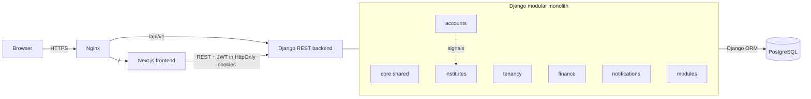
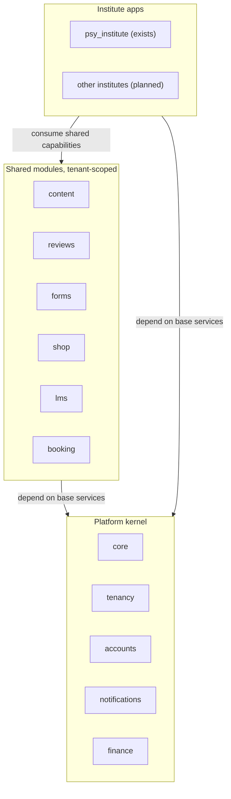

# Architecture Specification: Scalable Modular Monolith

This document is the source of truth for the platform's architecture. All new code — backend apps, frontend features, and infrastructure — must follow these principles.

## Overview



### Layers



Modules and the kernel never import an institute. Only `psy_institute` exists today; other institutes are planned.

## 1. Backend Architecture (Django REST Framework)

**Pattern**: Modular Monolith — a single Django project divided into isolated, domain-specific apps.

- One Django project (`backend/config/`) with settings split into `base` / `dev` / `prod` / `test`.
- Kernel apps live in `backend/apps/kernel/`: `core` (shared base model, API middleware, private media storage, health check), `accounts` (custom User + cookie JWT), `tenancy` (institutes and memberships), `finance` (wallet, ledger, payments, withdrawals in IRR), and `notifications` (SMS). Django app labels stay `core`, `accounts`, `tenancy`, `finance`, `notifications`, so tables and migrations are unchanged.
- Three layers under `backend/apps/`:

| Layer | Location | Contents |
|---|---|---|
| Platform kernel | `kernel/core`, `kernel/accounts`, `kernel/tenancy`, `kernel/finance`, `kernel/notifications` | Base models and storage, auth, institutes and memberships, wallet and payments, SMS |
| Shared modules | `modules/*` | `content`, `reviews`, `forms`, `shop`, `lms`, `booking` (tenant-scoped, enabled per institute) |
| Institutes | `institutes/*` | `psy_institute` (only one that exists today); others planned |

- Each concrete app fully owns its business logic: `models.py`, `serializers.py`, `views.py`, `urls.py`, `admin.py`, `signals.py`.

### Transitional state

- Shop, courses, content, booking, and reviews HTTP live in `apps/modules` at `/api/v1/institutes/<slug>/...`. `/api/v1/psy/` keeps thin adapters for one compatibility release. Modules emit signals (`order_paid`, `order_shipped`, `enrollment_confirmed`, and the booking signals). psy listens only when the object belongs to psy, and sends SMS.
- Kernel tenancy exposes `extend_payload`, `normalize_input`, and `person_name`. A module emits neutral names (`provider`, `customer`, `service_type`). Booking still accepts the legacy psychology lookups and payload keys (`therapist`, `patient`, `session_type`): `apps/modules/booking/models.py` rewrites those lookups onto `provider__therapist_profile` and `customer__patient_profile`, and `views.py` keeps `therapist_profile` and `patient_profile` in the compatibility payload. Those profiles stay on the psychology user. Other institutes do not require them.
- Vandar stays one gateway and one callback. `start_topup` and `start_checkout` store the institute, `return_host`, and `return_path` on the payment. The callback sends a custom frontend (psychology) and any payment without an institute to the stored path. A standard institute returns to its canonical domain, or, when it has none, to `PLATFORM_FRONTEND_ORIGIN/i/<slug>` plus the stored path. An empty `PLATFORM_FRONTEND_ORIGIN` must not turn that case into a hostless `/i/<slug>/...` redirect.
- Booking roles are institute membership plus a `Provider` row (`IsBookingAdmin`, `IsProvider`, `IsCustomer`). The cancel window reads `institute.settings.booking.cancel_window_hours` (default 24) and `refund_on_late_cancel`.
- A completed appointment has one `booking.AppointmentReview`. `PsyReviewContext` is still written for the psychology adapter.
- Legacy `psy_*` groups (dual-write), `groups` on `/auth/me`, and old psy model classes remain for one compatibility release.
- **Rationale**: prevents codebase entanglement while avoiding the infrastructure and networking overhead of microservices.

### App isolation rules

1. An app may read another app's models via direct Python imports and ORM queries.
2. An app must **never write** to another app's tables directly. Cross-app side effects go through **Django Signals** (or explicit service functions exposed by the owning app).
3. Foreign keys across apps are allowed — that is the point of the shared database — but the owning app defines the model.
4. New domains get a new app; do not grow unrelated logic inside an existing app.

## 2. Frontend Architecture (Next.js)

**Pattern**: Modular monolith — one Next.js App Router app with **strict bounded contexts**. Each institute is a folder that owns its routes, UI, hooks, and API. University landing never shares code with an institute.

### Directory map

```
frontend/
  components/                 # generic primitives only (ThemeToggle, ThemeProvider)
  lib/                        # platform kernel (API client, datetime)
  modules/                    # shared capabilities (content, shop, lms, forms, booking, reviews)
  templates/
    standard/                 # standard institute shell and routes (/i/<slug>)
  features/
    auth/                     # platform login/session (no institute CSS)
    finance/                  # platform wallet/ledger helpers
    tenancy/                  # institute context, guards, hrefs
    news/                     # university news
    think-tanks/              # university think-tanks
  app/
    (public)/                 # university marketing
      _components/            # university chrome + landing sections
    (auth)/                   # platform login/register
    (institutes)/
      (psy_institute)/
        _shared/              # psy kernel: api, types, hooks, tokens.css
        (psy)/_components/    # marketing fat files
        (patient)/_components/
        (therapist)/_components/
        (admin)/_components/
```

Route `page.tsx` files stay **thin composers**. Business UI lives in that portal’s `_components/` as cohesive files (~400–900 LOC). Split only when a second *feature* appears — never create `hooks/`, `ui/`, `views/`, or `lib/` inside an institute.

### Zero-Crossing Rule

1. `app/(public)/**` must never import `app/(institutes)/**` or `features/institutes/**`.
2. `app/(institutes)/(A_institute)/**` must never import `app/(institutes)/(B_institute)/**`.
3. University Header may **link** to `/psy` (URL only). It must not import psy components, CSS, types, or hooks.
4. Allowed downward imports: `@/lib/*`, `@/components/*`, `@/features/auth`, `@/features/finance`, `@/features/tenancy`, `@/modules/*` (plus university-only `features/news` and `features/think-tanks` from `(public)`). `modules/` and `features/tenancy` must not import an institute or university presentation.
5. Inside one institute, portals may import that institute’s `_shared/` only — not another portal’s `_components/`.
6. Shared capabilities live in `frontend/modules/`. Do **not** create `features/institutes/_shared`. If two institutes need an API-free primitive, promote it to `frontend/components/`.

ESLint `no-restricted-imports` zones enforce this in CI (`npm run lint`).

### Add an institute (copy-paste)

Scaffold next to routes. Do not create `features/institutes/_shared`.

```
app/(institutes)/(<slug>_institute)/
  _shared/                 # api.ts, types.ts, use-<slug>.ts, helpers.ts, tokens.css
  (<public>)/              # marketing portal
    layout.tsx
    _components/           # fat files (landing, header, …)
    <url-prefix>/page.tsx  # e.g. legal/page.tsx → /legal
  (<role>)/                # optional: patient, staff, admin
    layout.tsx             # guard + shell
    _components/
    <role>/…/page.tsx
```

Checklist (same PR as the first page — non-negotiable):

1. Create `_shared/` + one public portal. Add role portals only when needed.
2. Register ESLint zones in `frontend/eslint.config.mjs` by adding one call — public/auth/kernel already ban all of `app/(institutes)`:

   ```js
   ...instituteZones("foo", ["foo", "admin"]),
   ```

   `instituteZones` bans university UI, other institutes, and sibling portal `_components/`. Copy the helper; do not weaken it.
3. Update `frontend/ROUTES.md` with the URL prefix and code locations (`_shared` vs portal `_components`).
4. Do not touch `(public)` or `(psy_institute)` except a Header **URL** link if the institute is listed there.

The URL prefix (`/legal`, `/art`, …) is the only public contract. If two institutes need the same widget, promote an API-free primitive to `frontend/components/` or duplicate.

## 3. Database Architecture

**Pattern**: Centralized relational database — **PostgreSQL**.

- A single shared database lets the Django ORM handle relationships (foreign keys) across apps, guaranteeing data integrity with no cross-service synchronization.
- Configuration comes exclusively from environment variables (via `django-environ`); no credentials in code.

## 4. Communication & Integration

| Channel | Mechanism |
|---|---|
| Backend app-to-app | Direct Python imports and ORM reads; Django Signals for decoupled cross-app events |
| Client-to-server | RESTful APIs with JSON payloads, versioned under `/api/v1/`, documented with OpenAPI (drf-spectacular) |
| Authentication | JWT via `HttpOnly` cookies (see Security below) |

## 5. Authentication & Security (JWT via HttpOnly cookies)

To prevent token theft through XSS, cryptographic tokens are **never exposed to JavaScript**:

- **Token storage**: access and refresh tokens are issued exclusively as `HttpOnly`, `Secure`, `SameSite=Lax` cookies. They are never returned in JSON bodies and never stored in Zustand, LocalStorage, or SessionStorage.
- **Backend**: `djangorestframework-simplejwt` wrapped by custom login/refresh/logout views that set/clear the cookies. The refresh cookie is path-scoped to the refresh endpoint; logout blacklists the refresh token. A custom DRF authentication class reads the access token from the cookie instead of the `Authorization` header.
- **CSRF**: cookie-based auth requires CSRF protection on mutation endpoints — `SameSite=Lax` plus Django's CSRF middleware; the frontend forwards the CSRF token header on mutations.
- **CORS**: `CORS_ALLOW_CREDENTIALS = True` with an explicit frontend origin allowlist (wildcards are incompatible with credentialed requests).
- **Frontend**: the API client (`frontend/lib/api/client.ts`) sends every request with `credentials: 'include'` so the browser attaches cookies automatically. On a 401 it runs a **single-flight** silent refresh: concurrent 401s share one in-flight `/auth/refresh/` promise (so rotated refresh tokens are never invalidated by parallel refresh races), then each waiter retries once; if refresh fails, session state is cleared exactly once. CSRF uses Django's double-submit cookie pattern: bootstrap `GET /auth/csrf/` sets the non-HttpOnly `csrftoken` cookie; the client parses it from `document.cookie` and attaches `X-CSRFToken` on POST/PUT/PATCH/DELETE (never from a JSON body; never from LocalStorage).

## 6. Frontend State Management

- **React Query** (`@tanstack/react-query`) for all server state: API fetching, caching, and invalidation. No hand-rolled fetch-in-`useEffect`.
- **Zustand** only for lightweight, **non-sensitive** global client state: UI toggles, an `isAuthenticated` flag, and basic user profile data fetched from `/api/v1/auth/me/`. Never cryptographic tokens or other secrets.

## Roadmap

1. **Phase 1 — Monorepo restructure** (done): `frontend/` + `backend/` layout, this document.
2. **Phase 2 — Backend foundation** (done): Django project, split settings, PostgreSQL config, cookie-based JWT auth, custom User model, four domain namespaces.
3. **Phase 3 — Frontend foundation** (done): React Query + Zustand, feature directories, same-origin API client with `credentials: 'include'`, cookie JWT login page, think-tanks/news feature adapters.
4. **Phase 4 — Infrastructure**: docker-compose with postgres + backend + frontend, nginx routing `/api/` to the backend, CI jobs for both stacks.
5. **Later phases**: `psy_institute` and `finance` are in place. Payments go through the Vandar gateway. Shop, courses (`lms`), content, booking, and reviews HTTP already live in `apps/modules` at `/api/v1/institutes/<slug>/...`. `/api/v1/psy/` keeps thin adapters for one compatibility release. Notifications and further institutes follow.

## 7. Tenancy (phase 1A)

`apps.kernel.tenancy` is the kernel for centers. An `Institute` has a stable slug, `enabled_modules`, and `frontend_mode`. A user has one `InstituteMembership` per institute and any combination of `admin`, `staff`, and `member` roles. Authorization reads memberships. `is_staff` is not a clinic bypass.

For one compatibility release, psy memberships also write the legacy `psy_admin`, `psy_therapist`, and `psy_patient` groups, and registration that omits an institute joins psy (`TENANCY_COMPAT_REGISTER_INSTITUTE`). `/auth/me/` returns `memberships` and `groups`. The psy patient profile is created by a membership receiver, not by `accounts`.

Legacy `/api/v1/psy/...` routes stay. `LegacyCapabilityMiddleware` returns 404 when the matching capability is absent from psy `enabled_modules`. The capability list is `backend/module-registry.json`; `dump_module_registry --check` keeps it aligned with code. New institutes cannot enable a capability until its `ready` flag is true. Psy may keep unready capabilities because the legacy routes still serve them.

Startup does not migrate. Run `python manage.py migrate` as its own release step (`backend/deploy/routine-command.md`). Set `RUN_MIGRATIONS=1` only for a local stack that should migrate itself.

Cookie auth mutations (login, register, OTP, password reset, refresh, logout) enforce CSRF even though they do not use cookie authentication. Gateway callbacks stay exempt. `next` redirects accept only a decoded local path.

`Payment`, `LedgerEntry`, and `WithdrawalRequest` carry a nullable `institute`. Null stays platform-wide and is not backfilled onto psy. Institute admin finance reads only rows attributed to that institute and does not show a member's global wallet balance. `finance.manage_platform_finance` is the platform finance permission. Public payment purposes cannot use module reference prefixes.

`TENANCY_WRITE_PAUSE` is a list of module ids. While a module is listed, its mutation routes return 503. Reads and the payment callback stay open. See `backend/deploy/DOMAIN-OPERATIONS.md`.

## 8. Domains, extensions, and promotion

`InstituteDomain` stores one normalized hostname per row, at most one canonical domain per institute, and only a hash of the TXT challenge for `_university-verify.<hostname>`. Verification does not activate a domain. Activation requires a verified challenge and a recorded TLS-ready time, then locks the institute and writes a `TenancyAuditEvent`. Revocation clears the active flag first.

`GET /api/v1/tenancy/resolve/` and `GET /api/v1/institutes/<slug>/config/` are public and `no-store`. A bound host must match the URL slug. Neutral hosts are `TENANCY_NEUTRAL_HOSTS`. The university host stays in frontend configuration and does not call the resolver. Other hosts use a 60-second cache and a 10-minute last-known-good window, then 503.

An institute extension stays in `apps/institutes/<name>/` and is mounted at `/api/v1/institutes/<slug>/extensions/<key>/`. Shared modules never import an institute. A capability moves into `apps/modules/` only after a second consumer exists: inventory, copy with preserved identifiers, one writer, then contract the old tables after reconciliation. `onboard_institute` creates an inactive standard institute. It does not copy a backend or activate a domain.
